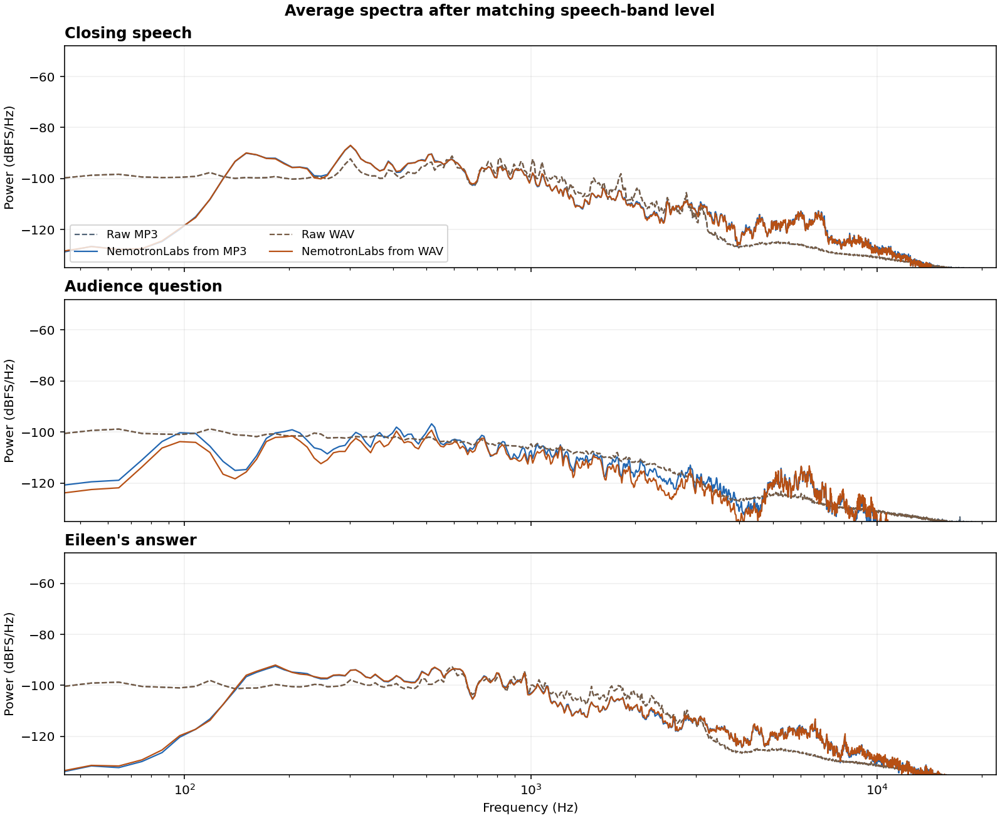

# Eileen Chang audio cleanup

Clean the archival recording of **Eileen Chang, “Chinese Translation: A Vehicle of Cultural Influence”** using [NVIDIA NemotronLabs RE-USE](https://huggingface.co/nvidia/NVIDIA-NemotronLabs-RE-USE) and FFmpeg.

Outputs preserve the complete input recording. The web MP3 runs approximately 105 minutes and includes a subsequent seminar. The archival WAV runs approximately 73 minutes. Standard output names:

- `outputs/NVIDIA_NemotronLabs_REUSE_full_recording.flac` — lossless, 44.1 kHz mono master.
- `outputs/NVIDIA_NemotronLabs_REUSE_full_recording.m4a` — smaller AAC listening copy at 192 kb/s.

Audio files are ignored by Git and can be shared separately as release attachments. Checksums and validation results for both restorations are in [docs/release-assets.json](docs/release-assets.json).

## Google Colab

Colab runs Jupyter `.ipynb` notebooks with an optional GPU.

1. [Open in Colab](https://colab.research.google.com/github/jianershi/eileen-chang-clean-up/blob/main/REUSE_full_recording_GPU.ipynb) and select a **T4 GPU** runtime.
2. Choose **Runtime → Run all**. The notebook downloads the code from this repository.
3. Upload your complete original audio when prompted, then download the new FLAC and M4A results.

Colab's free GPU availability varies. Its default `/content/` storage is temporary; preserve the entire work directory to resume after a VM reset.

## Kaggle

We used Kaggle for background execution with **Save Version → Save & Run All**. Import the [laughter restoration notebook](REUSE_laughter_Kaggle.ipynb), keep it private, and attach the archival WAV as a private input dataset. Select **GPU T4 x2** and enable **Internet**. The workflow uses one T4 and saves FLAC and M4A under `/kaggle/working/reuse_laughter_outputs`.

On a Tesla T4, the **1:12:45.67 archival WAV** took **1:08:27** for the laughter run and **1:12:00** for the standard run. These are the recorded times through inference, before final stitching, loudness normalization and export.

## Command line

Requires Python 3.10+ and FFmpeg/ffprobe. Enhancement needs a Linux x86_64 NVIDIA CUDA GPU; CPU export and verification also work on macOS. Python 3.13 matches the original T4 run.

```sh
python -m venv .venv
source .venv/bin/activate
python -m pip install -e .
python scripts/setup_gpu.py --install-torch
python -m eileen_cleanup restore /path/to/recording.ext
python -m eileen_cleanup verify outputs/NVIDIA_NemotronLabs_REUSE_full_recording.flac
python -m eileen_cleanup verify outputs/NVIDIA_NemotronLabs_REUSE_full_recording.m4a
```

Use any complete source encoding supported by FFmpeg. Rerun the same command to resume; keep the source and configuration unchanged. `--overwrite` replaces existing outputs deliberately. If GPU memory runs out, use `--core-seconds 10` and a new `--work-dir`.

After all GPU chunks finish, export on a CPU with `finalize`. To encode only an M4A from an existing restored FLAC, use `m4a`:

```sh
python -m eileen_cleanup finalize --work-dir work/nemotron-restoration
python -m eileen_cleanup m4a outputs/NVIDIA_NemotronLabs_REUSE_full_recording.flac
```

## Processing

The workflow uses a 60 Hz high-pass filter, float32 NemotronLabs RE-USE inference with 20-second cores and 2-second context, one-second crossfade margins, and measured loudness normalization targeting -20 LUFS. The model revision is pinned in `src/eileen_cleanup/profile.py`; model files download separately. Checkpoints support validated resumption.

The new model is pinned to revision `31f82f2efad1095034492f236e8dac9239ba713b`. The full 105-minute Colab run completed on a Tesla T4 with Torch 2.10.0+cu130; both exports were independently verified after download. Its separate cache and output names preserve the earlier restoration. Enhancement may introduce artifacts, so keep the original for comparison.

## Transcription comparison

We scored the full main speech against **4,261 normalized reference words** from the published text cited below. The MP3 interval is **02:31.270–39:35.070** and the waveform-aligned WAV interval is **02:31.048–39:31.975**.

**Word Error Rate (WER)** is the number of substitutions, deletions and insertions divided by the reference word count. Lower is better.

| Audio | Model version (revision) | Word errors | Word Error Rate (WER) | Substitutions | Deletions | Insertions |
|---|---|---:|---:|---:|---:|---:|
| Raw web MP3 | — | 856 | 20.09% | 517 | 205 | 134 |
| Original NVIDIA RE-USE | [`0ee3101`](https://huggingface.co/nvidia/RE-USE/tree/0ee310117ef0ae1e652654c821cf140bdcdc8415) | 814 | 19.10% | 542 | 151 | 121 |
| NVIDIA NemotronLabs RE-USE from MP3 | [`31f82f2`](https://huggingface.co/nvidia/NVIDIA-NemotronLabs-RE-USE/tree/31f82f2efad1095034492f236e8dac9239ba713b) | 788 | 18.49% | 501 | 153 | 134 |
| UniPASE | [`f0b4d4c`](https://huggingface.co/Xiaobin-Rong/unipase/tree/f0b4d4c4411fe08fc2dddbf2d9f33260c27ac4a0) | 824 | 19.34% | 535 | 160 | 129 |
| Cisco StuPASE | [`539963f`](https://huggingface.co/cisco-ai/stupase/tree/539963f425ae201ac8c379b6480e3b182a4840ad) | 893 | 20.96% | 616 | 151 | 126 |
| Raw archival WAV | — | 834 | 19.57% | 543 | 163 | 128 |
| NemotronLabs from WAV | [`31f82f2`](https://huggingface.co/nvidia/NVIDIA-NemotronLabs-RE-USE/tree/31f82f2efad1095034492f236e8dac9239ba713b) | 808 | 18.96% | 552 | 128 | 128 |
| **NemotronLabs laughter from WAV** | [`1b1521d`](https://huggingface.co/nvidia/NVIDIA-NemotronLabs-RE-USE-laughter/tree/1b1521dd659608e1e063ada83e0acfe1da473a8b) | 704 | **16.52%** | 461 | 119 | 124 |

The laughter variant reduced WER by **2.44 percentage points** (104 fewer errors) compared with standard NemotronLabs on the same archival WAV.

Versions identify the exact model repository revisions used, rather than release numbers. UniPASE used `enable_plc=True`; StuPASE used 8 steps, CFG 0.5 and sway -1.

All conditions used Whisper large-v3 with 82 matched speech windows, CPU int8, beam size 5, temperature 0 and English recognition, with no VAD, text prompts or previous-text conditioning. The reference was used only for scoring.

Both raw sources were decoded and resampled for recognition; the restored outputs include their existing preparation and loudness processing. These scores compare the resulting audio files, rather than isolated model architectures. They measure transcription errors against an edited publication, which may differ from the delivered speech; they are not hallucination rates or human listening scores.

## Frequency comparison

The plots show average spectral power for the closing speech, an audience question, and Eileen’s reply. Frequency increases from left to right on a logarithmic scale. Each comparison uses matched levels in the 300–3,000 Hz speech band. The Q&A panels use Eileen’s reply as the level reference.

The dashed traces show the raw web MP3 and archival WAV. The solid traces show standard NemotronLabs RE-USE applied to each source. The raw traces overlap closely across most of the plotted speech range.



Both restorations below use the archival WAV. The traces are close across much of the speech band. In the closing speech and Eileen’s reply, the standard model generally has more energy around 4–10 kHz. This band can contain consonant detail and noise.


## License and credits

Project code: [MIT](LICENSE). NVIDIA's model and implementation use [OpenMDW 1.1](https://huggingface.co/nvidia/NVIDIA-NemotronLabs-RE-USE/blob/31f82f2efad1095034492f236e8dac9239ba713b/LICENSE), which permits commercial use. The archival audio retains its separate terms below.

**Audio copyright: Schlesinger Library of Harvard. Noncommercial reuse with attribution is permitted.** Include this README when sharing the enhanced audio. Published text, PDFs and subtitles are not included.

[Original audio](https://mps.lib.harvard.edu/sds/audio/503996508) · [Catalog record](https://hollisarchives.lib.harvard.edu/catalog/sch01475_sch01475c00589) · [Library citation guide](https://guides.library.harvard.edu/schlesinger/citation_guide)

> Radcliffe College Archives sound recordings collection, 1951–2008. Bunting Institute Seminars. Reyher; Bas-Comain. undatedd. RG XX, Series 8–9, RA.T-106/nd., Audiotape 01. Schlesinger Library, Radcliffe Institute, Harvard University, Cambridge, Mass. https://hollisarchives.lib.harvard.edu/catalog/sch01475_sch01475c00589. Accessed October 23, 2026.

Thanks to Schlesinger Library and its archivists for preserving and providing access to the recording, and to journalist **Chai Jing / 柴静** for reporting on its rediscovery: [substack](https://chaijing.substack.com/p/767), [YouTube note](https://www.youtube.com/post/UgkxVZFF41EiWCfXv78iSDDW0gkHSGkU02ue), [channel](https://www.youtube.com/@chaijing2023).

Enhancement research for [NVIDIA NemotronLabs RE-USE](https://huggingface.co/nvidia/NVIDIA-NemotronLabs-RE-USE) and its [laughter variant](https://huggingface.co/nvidia/NVIDIA-NemotronLabs-RE-USE-laughter):

- **Szu-Wei Fu et al.** “Rethinking Training Targets, Architectures and Data Quality for Universal Speech Enhancement” (2026). [arXiv:2603.02641](https://arxiv.org/abs/2603.02641)
- **Szu-Wei Fu et al.** “One Model, Many Latencies: Universal Speech Enhancement for Diverse Real-Time Applications” (2026). [arXiv:2606.25621](https://arxiv.org/abs/2606.25621)

Related scholarship: **EILEEN CHANG and CHRISTOPHER LEE.** “Chinese Translation: A Vehicle of Cultural Influence.” *PMLA* 130, no. 2 (2015): 488–98. [JSTOR](https://www.jstor.org/stable/44015733). Referenced for research; its text is not distributed here.

## Development

```sh
python -m pip install -e '.[dev]'
python -m unittest discover -s tests -v
python -m build
python scripts/package_source.py
```
