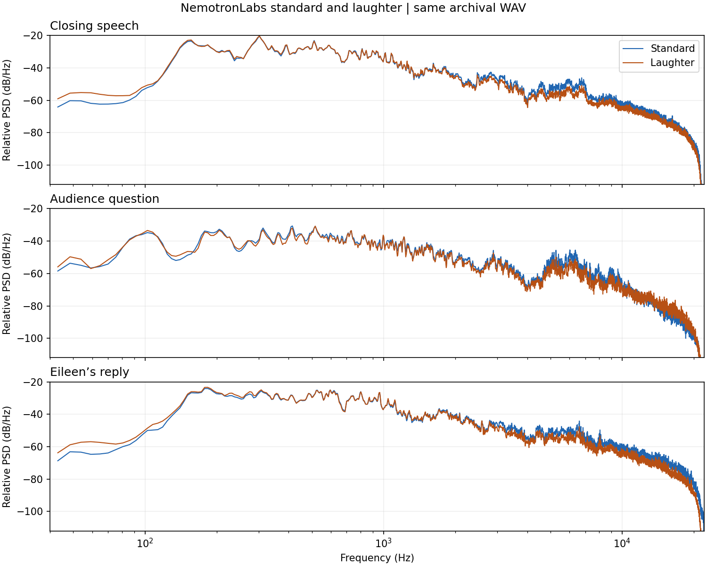
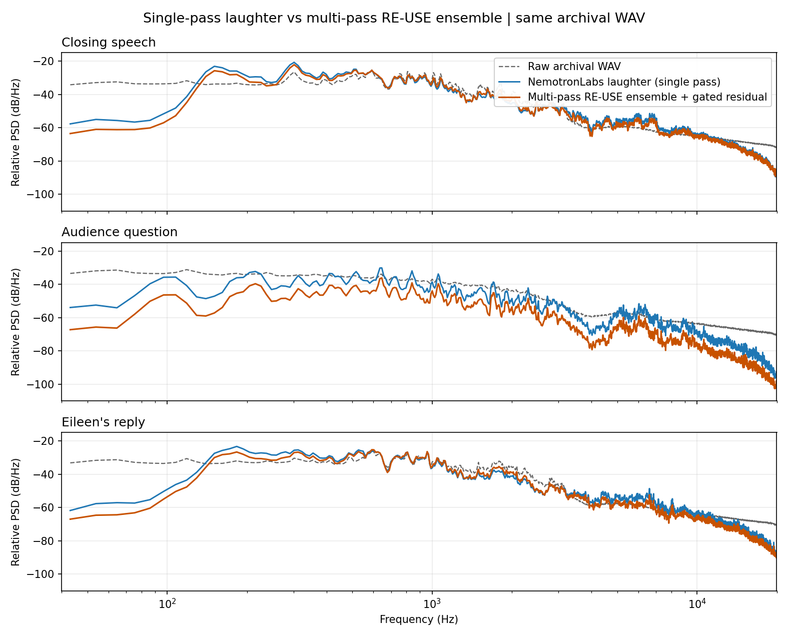

# Eileen Chang audio cleanup

Restore the archival recording of **Eileen Chang, “Chinese Translation: A Vehicle of Cultural Influence”** with [NVIDIA NemotronLabs RE-USE](https://huggingface.co/nvidia/NVIDIA-NemotronLabs-RE-USE) and FFmpeg.

[](https://www.youtube.com/watch?v=F9ZVtb9nTkU)

Each output keeps the full length of the input recording. The web MP3 is about 105 minutes long and includes a second seminar. The archival WAV is about 73 minutes long. Standard output files:

- `outputs/NVIDIA_NemotronLabs_REUSE_full_recording.flac` — 44.1 kHz mono lossless master.
- `outputs/NVIDIA_NemotronLabs_REUSE_full_recording.m4a` — 192 kb/s AAC listening copy.

Git ignores audio files. Share them separately as release attachments. Checksums and validation records for earlier releases are in [docs/release-assets.json](docs/release-assets.json).

## Platforms and reproducibility

The execution platform does not change the audio result. Float32 inference with the same model revision and pipeline settings produces equivalent audio across Google Colab, Kaggle, and local hardware.

On a 24-second, 44.1 kHz archival test chunk, a float32 Apple Silicon MLX port matched the Tesla T4 CUDA output with a correlation of `0.999998` (`-85.5 dB` RMS difference). Differences in the benchmark table below come from the source file, model checkpoint, multi-pass fusion, and loudness processing, not from the platform.

### Google Colab

1. [Open the notebook in Colab](https://colab.research.google.com/github/jianershi/eileen-chang-clean-up/blob/main/REUSE_full_recording_GPU.ipynb) and select a **T4 GPU** runtime.
2. Select **Runtime → Run all**. The notebook downloads the code from this repository.
3. Upload the complete original audio when prompted. Download the FLAC and M4A outputs after the run finishes.

Free GPU availability on Colab varies. Default `/content/` storage is temporary. Save the full work directory if you need to resume after a VM reset.

### Kaggle

Use Kaggle for background runs with **Save Version → Save & Run All**.

1. Import the [laughter restoration notebook](REUSE_laughter_Kaggle.ipynb) as a private notebook.
2. Attach the archival WAV as a private input dataset.
3. Select **GPU T4 x2** and enable **Internet**.

The notebook uses one T4 GPU and writes FLAC and M4A outputs to `/kaggle/working/reuse_laughter_outputs`. On a Tesla T4, inference on the **1:12:45.67 archival WAV** took **1:08:27** for the laughter checkpoint and **1:12:00** for the standard checkpoint (before joining, normalization, and export).

### Command line

The CLI requires Python 3.10+ and FFmpeg/ffprobe. Enhancement supports Linux x86_64 with an NVIDIA CUDA GPU (`--backend cuda`) and Apple Silicon macOS with MLX (`--backend mlx`). `--backend auto` selects the available backend automatically. Python 3.13 matches the original T4 runs.

Install on Linux x86_64 with CUDA:

```sh
python -m venv .venv
source .venv/bin/activate
python -m pip install -e '.[ensemble]'
python scripts/setup_gpu.py --install-torch
```

Install on Apple Silicon macOS with MLX:

```sh
python -m venv .venv
source .venv/bin/activate
python -m pip install -e '.[mlx]'
```

Run the recommended multi-pass ensemble (outputs `outputs/REUSE_ensemble_full_recording.flac` and `.m4a`):

```sh
python -m eileen_cleanup ensemble /path/to/recording.ext
python -m eileen_cleanup verify outputs/REUSE_ensemble_full_recording.flac
python -m eileen_cleanup verify outputs/REUSE_ensemble_full_recording.m4a
```

If you already have a pre-normalization 44.1 kHz float32 laughter `joined.wav`, pass `--pass1-joined /path/to/joined.wav` to skip Pass 1.

To run the single-pass standard RE-USE workflow instead:

```sh
python -m eileen_cleanup restore /path/to/recording.ext
python -m eileen_cleanup verify outputs/NVIDIA_NemotronLabs_REUSE_full_recording.flac
python -m eileen_cleanup verify outputs/NVIDIA_NemotronLabs_REUSE_full_recording.m4a
```

You can pass any complete source file supported by FFmpeg. Run the same command again to resume from validated checkpoints; keep the source file and settings unchanged. Use `--overwrite` to replace existing outputs. If GPU memory runs out, use `--core-seconds 10` with a new `--work-dir`.

After all enhancement chunks finish, run `finalize` on a CPU to join and export both formats. To encode only an M4A from an existing FLAC, run `m4a`:

```sh
python -m eileen_cleanup finalize --work-dir work/nemotron-restoration
python -m eileen_cleanup m4a outputs/NVIDIA_NemotronLabs_REUSE_full_recording.flac
```

## Processing

### Single-pass RE-USE workflow

1. Apply a 60 Hz high-pass filter and resample to 44.1 kHz mono float32.
2. Run float32 RE-USE inference in 20-second cores with 2-second context on each side.
3. Scale each window to a 0.85 peak (capped at 20x gain) before inference, then undo the gain.
4. Join windows with 1-second raised-cosine crossfades.
5. Apply FFmpeg `dynaudnorm`, two-pass `loudnorm` targeting `-20 LUFS` (`-3 dBTP`), and a true-peak limiter (`0.708`).

The default standard model is pinned to revision `31f82f2efad1095034492f236e8dac9239ba713b` in [src/eileen_cleanup/profile.py](src/eileen_cleanup/profile.py). Model weights download separately. Enhancement can introduce artifacts, so keep the original recording for comparison.

### Multi-pass RE-USE ensemble (lowest WER)

The multi-pass workflow improves intelligibility over a single 44.1 kHz laughter pass without using a generative vocoder. It combines three float32 RE-USE passes on the same 60 Hz high-pass archival WAV, blends a speech-gated band-limited residual from the raw tape, and replaces dynamic normalization with constant linear gain:

1. **Pass 1 (44.1 kHz laughter):** Run `NVIDIA-NemotronLabs-RE-USE-laughter` (`1b1521d`) at 44.1 kHz (20 s cores, 2 s context, 1 s crossfades).
2. **Pass 2 (16 kHz staggered laughter):** Run `NVIDIA-NemotronLabs-RE-USE-laughter` (`1b1521d`) at 16 kHz with chunk boundaries shifted by **+10 seconds** relative to Pass 1.
3. **Pass 3 (16 kHz standard):** Run `NVIDIA-NemotronLabs-RE-USE` (`31f82f2`) at 16 kHz.
4. **Multi-resolution mix (0–7.2 kHz crossover):** Resample Passes 2 and 3 to 44.1 kHz, time-align them to Pass 1, and match speech-band RMS. Below 7.2 kHz, mix **50%** Pass 1, **30%** Pass 2, and **20%** Pass 3. Above 7.2 kHz, keep **100%** of Pass 1 to preserve full-band rolloff.
5. **Speech-gated archival residual (180–3,600 Hz):** Band-pass the raw archival WAV to 180–3,600 Hz (where real speech SNR resides; below 150 Hz is rumble and above 4.5 kHz is tape hiss). Apply gentle STFT Wiener denoising (8 dB maximum attenuation), time-align and level-match it to the neural mix, and blend **20%** back during active speech only. A smooth 40 ms RMS envelope gate drops the blend to 0% during pauses.
6. **Linear loudness mastering:** Measure integrated loudness, apply one constant linear gain targeting `-20 LUFS`, and apply the `-3 dBTP` (`0.708`) safety limiter. Do not apply `dynaudnorm` or dynamic `loudnorm`.

Because the 16 kHz passes have different STFT bin widths (`n_fft = 640` vs `1764`), staggered chunk boundaries, and a second checkpoint, independent neural artifacts partially cancel when averaged. The speech-gated residual restores consonant detail between 1.2 kHz and 3.2 kHz without adding pause noise.

## Transcription comparison

We scored the full main speech against **4,261 normalized reference words** from the published text cited below. The MP3 span is **02:31.270–39:35.070**. The waveform-aligned archival WAV span is **02:31.048–39:31.975**.

**Word Error Rate (WER)** is `(substitutions + deletions + insertions) / reference words`. Lower is better.

| Audio | Model revision(s) | Word errors | WER | Substitutions | Deletions | Insertions |
|---|---|---:|---:|---:|---:|---:|
| Raw web MP3 | — | 856 | 20.09% | 517 | 205 | 134 |
| Original NVIDIA RE-USE (from MP3) | [`0ee3101`](https://huggingface.co/nvidia/RE-USE/tree/0ee310117ef0ae1e652654c821cf140bdcdc8415) | 814 | 19.10% | 542 | 151 | 121 |
| NemotronLabs standard (from MP3) | [`31f82f2`](https://huggingface.co/nvidia/NVIDIA-NemotronLabs-RE-USE/tree/31f82f2efad1095034492f236e8dac9239ba713b) | 788 | 18.49% | 501 | 153 | 134 |
| UniPASE (from MP3) | [`f0b4d4c`](https://huggingface.co/Xiaobin-Rong/unipase/tree/f0b4d4c4411fe08fc2dddbf2d9f33260c27ac4a0) | 824 | 19.34% | 535 | 160 | 129 |
| Cisco StuPASE (from MP3) | [`539963f`](https://huggingface.co/cisco-ai/stupase/tree/539963f425ae201ac8c379b6480e3b182a4840ad) | 893 | 20.96% | 616 | 151 | 126 |
| Raw archival WAV | — | 834 | 19.57% | 543 | 163 | 128 |
| NemotronLabs standard (from WAV) | [`31f82f2`](https://huggingface.co/nvidia/NVIDIA-NemotronLabs-RE-USE/tree/31f82f2efad1095034492f236e8dac9239ba713b) | 808 | 18.96% | 552 | 128 | 128 |
| NemotronLabs laughter (single pass, from WAV) | [`1b1521d`](https://huggingface.co/nvidia/NVIDIA-NemotronLabs-RE-USE-laughter/tree/1b1521dd659608e1e063ada83e0acfe1da473a8b) | 704 | 16.52% | 461 | 119 | 124 |
| **Multi-pass RE-USE ensemble + gated residual (from WAV)** | [`1b1521d`](https://huggingface.co/nvidia/NVIDIA-NemotronLabs-RE-USE-laughter/tree/1b1521dd659608e1e063ada83e0acfe1da473a8b) + [`31f82f2`](https://huggingface.co/nvidia/NVIDIA-NemotronLabs-RE-USE/tree/31f82f2efad1095034492f236e8dac9239ba713b) | **669** | **15.70%** | **427** | **117** | **125** |

- Single-pass `NemotronLabs laughter` reduced WER by **2.44 percentage points** (104 fewer errors) compared with single-pass standard `NemotronLabs` on the same archival WAV.
- The **multi-pass RE-USE ensemble + gated residual** reduced WER by another **0.82 percentage points** (35 fewer errors) compared with single-pass `NemotronLabs laughter` on the same archival WAV.
- Ensemble weights were selected on 12 development windows. On the remaining 70 unseen windows (3,653 reference words), errors still dropped from 562 (`15.38%`) to 555 (`15.19%`). On a separate unseen 12-window check (650 reference words), WER dropped from `16.46%` to `14.46%`.

Revisions identify the exact Hugging Face model commits used. UniPASE used `enable_plc=True`; StuPASE used 8 steps, CFG 0.5, and sway `-1`.

All rows used the same offline Whisper large-v3 protocol: 82 matched speech windows, CPU `int8`, beam size 5, temperature 0, English recognition, and no VAD, text prompts, or previous-text conditioning. The published text was used only for scoring.

Raw sources were decoded and resampled to 16 kHz for recognition. Restored files include their preparation and loudness processing. These scores compare complete output audio files against an edited publication, which can differ from spoken delivery. They do not measure hallucination rates or human listening preference directly.

## Frequency comparison

The plots show average spectral power for the closing speech, an audience question, and Eileen’s reply. Frequency increases from left to right on a logarithmic scale. Each comparison matches levels in the 300–3,000 Hz speech band. The Q&A panels use Eileen’s reply as the level reference.

Dashed traces show the raw web MP3 and archival WAV. Solid traces show single-pass standard NemotronLabs RE-USE applied to each source. The raw traces overlap closely across most of the speech range.


Both restorations below use the archival WAV. The traces stay close across most of the speech band. In the closing speech and Eileen’s reply, the standard model has more energy around 4–10 kHz, which can contain both consonant detail and noise.



The plot below compares single-pass `NemotronLabs laughter` with the multi-pass RE-USE ensemble on the archival WAV. Compared with the single-pass output, the ensemble lowers low-frequency rumble below 120 Hz by 4.7–5.9 dB and restores muted 1.2–3.2 kHz formant energy closer to the raw speech. Because linear mastering replaces `dynaudnorm`, the quiet audience question stays at its natural level relative to Eileen’s reply instead of being boosted.



## License and credits

Project code uses [MIT](LICENSE). NVIDIA’s model and code use [OpenMDW 1.1](https://huggingface.co/nvidia/NVIDIA-NemotronLabs-RE-USE/blob/31f82f2efad1095034492f236e8dac9239ba713b/LICENSE), which permits commercial use. The archival audio keeps its separate terms below.

**Audio copyright: Schlesinger Library of Harvard. Noncommercial reuse with attribution is permitted.** Include this README when you share restored audio. Published text, PDFs, and subtitles are not included.

[Original audio](https://mps.lib.harvard.edu/sds/audio/503996508) · [Catalog record](https://hollisarchives.lib.harvard.edu/catalog/sch01475_sch01475c00589) · [Library citation guide](https://guides.library.harvard.edu/schlesinger/citation_guide)

> Radcliffe College Archives sound recordings collection, 1951–2008. Bunting Institute Seminars. Reyher; Bas-Comain. undatedd. RG XX, Series 8–9, RA.T-106/nd., Audiotape 01. Schlesinger Library, Radcliffe Institute, Harvard University, Cambridge, Mass. https://hollisarchives.lib.harvard.edu/catalog/sch01475_sch01475c00589. Accessed October 23, 2026.

Thanks to Schlesinger Library and its archivists for preserving and providing access to the recording, and to journalist **Chai Jing / 柴静** for reporting on its rediscovery: [substack](https://chaijing.substack.com/p/767), [YouTube note](https://www.youtube.com/post/UgkxVZFF41EiWCfXv78iSDDW0gkHSGkU02ue), [channel](https://www.youtube.com/@chaijing2023).

Enhancement research for [NVIDIA NemotronLabs RE-USE](https://huggingface.co/nvidia/NVIDIA-NemotronLabs-RE-USE) and its [laughter variant](https://huggingface.co/nvidia/NVIDIA-NemotronLabs-RE-USE-laughter):

- **Szu-Wei Fu et al.** “Rethinking Training Targets, Architectures and Data Quality for Universal Speech Enhancement” (2026). [arXiv:2603.02641](https://arxiv.org/abs/2603.02641)
- **Szu-Wei Fu et al.** “One Model, Many Latencies: Universal Speech Enhancement for Diverse Real-Time Applications” (2026). [arXiv:2606.25621](https://arxiv.org/abs/2606.25621)

Related scholarship: **EILEEN CHANG and CHRISTOPHER LEE.** “Chinese Translation: A Vehicle of Cultural Influence.” *PMLA* 130, no. 2 (2015): 488–98. [JSTOR](https://www.jstor.org/stable/44015733). Referenced for research; its text is not distributed here.

## Development

```sh
python -m pip install -e '.[dev]'
python -m unittest discover -s tests -v
python -m build
python scripts/package_source.py
```
